<div align="center">



<p><b>🛍️ E-commerce Website</b></p>

<p>
  
  
  
  
  
  
  
</p>

</div>

## 📖 Overview

**Empirical** is a fashion and lifestyle storefront built with **Next.js**. Customers can browse the product collection, read articles, explore events and the brand gallery, and manage their account, cart and orders.

## ✨ Key Features

### 🛒 Shopping

- Product catalog & product detail pages
- Shopping cart and order success flow
- Order history in the user profile

### 📰 Content

- Finance articles with detail pages
- Events with detail pages
- Gallery, Philosophy and Contact pages

### 🔐 Accounts

- Sign up, login, OTP verification, forgot & update password
- Protected routes via middleware
- Persisted auth state

### 🎨 Experience

- Smooth animations with Framer Motion & Lottie
- Carousels with Embla & Splide
- Custom loading & 404 pages

## 🛠️ Tech Stack

| Category | Technology |
|---|---|
| **Framework** | Next.js 16 (App Router) · React 19 |
| **Language** | TypeScript |
| **Styling** | Tailwind CSS v4 |
| **UI** | shadcn/ui (Radix) · Lucide · Sonner |
| **State** | Redux Toolkit · Redux Persist |
| **Animation** | Framer Motion · Lottie · React Type Animation |
| **Carousels** | Embla Carousel · Splide |

## 🚀 Getting Started

### Prerequisites

- Node.js 18+ and npm

### Installation

```bash
git clone https://github.com/moazzembhuiyan/imperialempirical-website.git
cd imperialempirical-website
npm install
```

### Environment Variables

Create a `.env.local` file in the project root:

```env
NEXT_PUBLIC_BASE_URL=
```

| Variable | Description |
|---|---|
| `NEXT_PUBLIC_BASE_URL` | Backend API base URL |

### Run

```bash
npm run dev
# open http://localhost:3000
```

## 📜 Available Scripts

| Command | Description |
|---|---|
| `npm run dev` | Start the development server |
| `npm run build` | Create a production build |
| `npm run start` | Run the production build |
| `npm run typecheck` | Run TypeScript type checking |
| `npm run lint` | Run ESLint |

## 📁 Project Structure

```text
src/
├── app/
│   ├── (auth)/      # Login, sign-up, OTP, password
│   ├── (public)/    # Products, articles, events, gallery...
│   └── (private)/   # Cart & profile
├── components/      # UI components
├── redux/           # Store & API
├── lottie/          # Animations
└── middleware.ts    # Route protection
```

## 📝 More Documentation

Detailed developer notes are available in [`docs/NOTES.md`](docs/NOTES.md).

---

<div align="center">

### 👨‍💻 Developed by [Moazzem Hossen Bhuiyan](https://github.com/moazzembhuiyan)

<sub>Mobile App Developer (React Native) • Web Developer</sub>

<p>
  <a href="https://github.com/moazzembhuiyan"></a>
  <a href="https://www.linkedin.com/in/moazzem-hossen-bhuiyan-325432331/"></a>
  <a href="mailto:moazzembhuiyan394@gmail.com"></a>
</p>

<sub>⭐ If you like this project, consider giving it a star!</sub>

</div>
